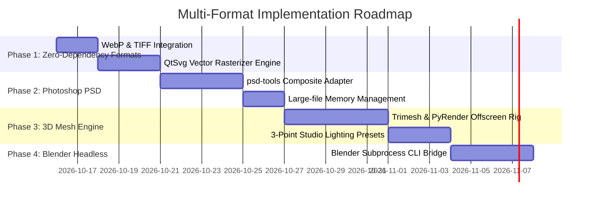

# PreviewGen: Multi-Format Preview Specification
**Document Version:** 1.0  
**Status:** Approved Architectural Blueprint  
**Core Invariant:** Strict preservation of the signature **Diagonal Triangle Split** across all asset types.

---

## 1. Executive Summary & Design Philosophy

PreviewGen's core differentiator is its **Diagonal Triangle Split**: dividing the preview canvas into two equal-area triangles along the diagonal (transparency checkerboard on one half, solid color on the other, divided by a crisp separator line).

Currently, PreviewGen only ingests transparent `.png` files. This specification defines the unified architecture to ingest **six additional file formats**:

1. **`.webp`** (Modern web & app transparent assets)
2. **`.tiff` / `.tif`** (High-end print & photography transparent assets)
3. **`.svg`** (Vector illustrations, icons, and logos)
4. **`.psd`** (Adobe Photoshop layered source files)
5. **`.obj` / `.gltf` / `.glb`** (Standard 3D meshes & game assets)
6. **`.blend`** (Native Blender 3D scene files)

### The Invariable Output Contract
Regardless of whether the input is a 2D vector, a 500MB Photoshop file, or a 3D polygonal model:
- **No variations in background geometry**: The background remains the proven **Triangle Split** (Left Solid / Right Transparent or vice-versa).
- **Unified RGBA Adapter Pattern**: Every format adapter produces an uncompressed, in-memory **`PIL.Image (RGBA)`** object.
- **Identical Downstream Composite**: The core `processor.py` engine receives the standardized RGBA buffer, renders the diagonal triangles, overlays the asset with zero distortion, applies the watermark/stroke, and outputs a high-res marketplace `.jpg`.

---

## 2. Ingestion Pipeline Architecture

```
[ Input File Ingestion ]
  ├── .png   ───► [ Native Pillow Loader ]
  ├── .webp  ───► [ WebP Chunk Parser ]
  ├── .tiff  ───► [ LibTIFF CMYK->sRGB Adapter ]
  ├── .svg   ───► [ QtSvg Vector Rasterizer ]           ──► [ Standardized RGBA Buffer ]
  ├── .psd   ───► [ PSD Composite Extractor ]                      │
  ├── .gltf  ─┐                                                    ▼
  ├── .glb   ─┼─► [ Headless 3D Studio Renderer ]       [ Core Triangle Split Engine ]
  ├── .obj   ─┘                                                    │
  └── .blend ───► [ Headless Blender CLI Subprocess ]              ▼
                                                        [ Marketplace-Ready .jpg ]
```

---

## 3. Format-by-Format Technical Specifications

### 3.1. WebP (`.webp`)
- **Use Case:** Favicons, UI stickers, web icons, modern alpha graphics.
- **Ingestion Library:** `Pillow` (native `libwebp` binding).
- **Technical Considerations:**
  - WebP supports both lossy and lossless compression with alpha channels (`VP8X` extended header).
  - Must verify `image.mode == "RGBA"`. If mode is `P` (palette-based) or `RGB`, convert via `image.convert("RGBA")`.
  - **Animated WebP Detection:** Check `getattr(image, "is_animated", False)`. If true, extract frame 0 or the frame with the largest non-transparent bounding box:
    ```python
    image.seek(0)
    rgba = image.convert("RGBA")
    ```
- **Validation Rule:** Must contain at least 1 transparent pixel and at least 1 non-transparent pixel (bounding box `getbbox() is not None`).

---

### 3.2. TIFF (`.tiff`, `.tif`)
- **Use Case:** High-resolution packaging artwork, print elements, scanned physical cutouts.
- **Ingestion Library:** `Pillow` (`libtiff`).
- **Technical Considerations:**
  - **Color Space Transform:** Many TIFFs use `CMYK` or 16-bit per channel (`I;16` or `RGBA;16`).
    - Must normalize 16-bit depths down to 8-bit per channel (`uint8`).
    - Convert CMYK TIFFs with alpha channels to sRGB:
      ```python
      if image.mode in ("CMYK", "YCbCr"):
          image = image.convert("RGB")
      rgba = image.convert("RGBA")
      ```
  - **Associated vs. Unassociated Alpha:** Pre-multiplied alpha must be un-premultiplied before compositing over the checkerboard to prevent dark halo artifacts along object edges.

---

### 3.3. SVG (`.svg`, `.svgz`)
- **Use Case:** Vector icon packs, digital stickers, typography badges, logo kits (Etsy, Freepik vector uploads).
- **Ingestion Library:** `resvg_py` (High-performance Rust-based SVG rasterizer).
- **Technical Considerations:**
  - **Resolution Target:** Unlike raster images that have fixed pixel counts, SVGs are infinitely scalable.
  - **Rasterization Strategy:**
    1. Parse native viewBox using `QSvgRenderer.viewBoxF()`.
    2. Determine aspect ratio $W / H$.
    3. Scale vector to fit standard marketplace preview resolution (e.g., matching 4000px on the longest edge, or honoring user-specified canvas resolution).
    4. Render onto a transparent `QImage`:
       ```python
       renderer = QSvgRenderer(svg_bytes_or_path)
       qimg = QImage(target_width, target_height, QImage.Format.Format_ARGB32_Premultiplied)
       qimg.fill(Qt.GlobalColor.transparent)
       painter = QPainter(qimg)
       renderer.render(painter)
       painter.end()
       ```
    5. Convert `QImage` to Pillow `Image` via raw buffer memory copy (`qimg.bits()`).

---

### 3.4. Photoshop Document (`.psd`)
- **Use Case:** Freepik & Adobe Stock contributors submitting multi-layer design elements requiring transparent previews.
- **Ingestion Library:** `psd-tools` (pure Python parser, no Photoshop installation required).
- **Technical Considerations:**
  - **Composite Fast-Path:** Photoshop saves a pre-flattened composite image inside the PSD binary header if the file was saved with "Maximize Compatibility" (standard for stock submissions).
    ```python
    from psd_tools import PSDImage
    psd = PSDImage.open(file_path)
    composite = psd.composite()  # Returns PIL.Image directly
    rgba = composite.convert("RGBA")
    ```
  - **Fallback Composite:** If composite is missing, iterate through visible layers and composite top-down:
    ```python
    image = psd.composite(apply_icc=True, ignore_preview=True)
    ```
  - **Memory Management:** Large PSDs (100MB–1GB) can exhaust RAM. Workers must explicitly call `del psd` and `gc.collect()` after extracting the RGBA buffer.

---

### 3.5. 3D Meshes (`.obj`, `.gltf`, `.glb`)
- **Use Case:** 3D icons, game props, stylized assets sold on CGTrader, TurboSquid, Blender Market.
- **Ingestion Engine:** Headless PyVista / Trimesh + PyRender.
- **Technical Considerations:**
  - **Automated Studio Setup:**
    - **Camera:** Fixed isometric 3/4 beauty angle: Azimuth $45^\circ$, Elevation $30^\circ$, centered on the mesh bounding-box center.
    - **Lighting Rig:** Balanced 3-point lighting setup:
      - Key light: 6000K warm white from top-front-left (intensity 1.0).
      - Fill light: 4500K soft neutral from front-right (intensity 0.4).
      - Rim light: Subtle edge highlight from behind (intensity 0.6).
    - **Background:** Clear transparent alpha buffer (`glClearColor(0, 0, 0, 0)`).
  - **Material Handling:**
    - For `.glb`/`.gltf`: Native PBR textures (BaseColor, Metallic, Roughness) loaded automatically.
    - For `.obj`: Load companion `.mtl` and diffuse textures if present in the same directory; fallback to clay/ambient-occlusion shading if textures are missing.
  - **Output:** Render directly to an offscreen buffer (e.g. 3000×3000 RGBA) and pass into the Triangle Split composite.

---

### 3.6. Blender Projects (`.blend`)
- **Use Case:** Complex procedural materials, geometry node assets, rigged models where external renderers fail.
- **Ingestion Engine:** Headless local Blender subprocess CLI (`blender -b`).
- **Technical Considerations:**
  - **Auto-Detection:** Detect `blender.exe` on Windows (`%ProgramFiles%\Blender Foundation\Blender *`), macOS (`/Applications/Blender.app`), or Linux (`/usr/bin/blender`).
  - **Execution Protocol:**
    PreviewGen dispatches an isolated batch rendering script:
    ```bash
    blender -b "input.blend" --python-expr "
    import bpy
    bpy.context.scene.render.film_transparent = True
    bpy.context.scene.render.image_settings.file_format = 'PNG'
    bpy.context.scene.render.image_settings.color_mode = 'RGBA'
    bpy.context.scene.render.filepath = 'output_temp.png'
    bpy.ops.render.render(write_still=True)
    "
    ```
  - The resulting transparent frame is ingested into the Triangle Split engine; temporary artifacts are deleted immediately.

---

## 4. Format Capabilities & Requirements Matrix

| Format | Category | Ingestion Engine | Alpha Support | Extra Dependencies | Target Release |
|---|---|---|---|---|---|
| **`.png`** | 2D Raster | Pillow | Native 8-bit | None (included) | Current (v1.0) |
| **`.webp`** | 2D Raster | Pillow | Native 8-bit | None (included) | **Phase 1** |
| **`.tiff` / `.tif`** | 2D Raster | Pillow | Native (8/16-bit) | None (included) | **Phase 1** |
| **`.svg`** | 2D Vector | `resvg_py` | Vector Alpha | None (`resvg_py` wheel) | **Phase 1** |
| **`.psd`** | 2D Layered | `psd-tools` | Multi-layer composite | `psd-tools` | **Phase 2** |
| **`.glb` / `.gltf`** | 3D Asset | `trimesh` + `pyrender` | Offscreen RGBA buffer | `trimesh`, `pyrender` | **Phase 3** |
| **`.obj`** | 3D Mesh | `trimesh` + `pyrender` | Offscreen RGBA buffer | `trimesh`, `pyrender` | **Phase 3** |
| **`.blend`** | 3D Scene | Headless Blender CLI | Cycles/Eevee Alpha Film | Local Blender install | **Phase 4** |

---

## 5. UI & Workflow Integration

1. **Folder Scanner Update:**
   - Modify the input directory scanner in `main.py` to recognize all active format extensions:
     ```python
     SUPPORTED_EXTENSIONS = {".png", ".webp", ".tiff", ".tif", ".svg", ".psd", ".glb", ".gltf", ".obj", ".blend"}
     ```
2. **Format Filter Chips in UI:**
   - In the "Folders" panel, display checkboxes allowing users to filter which file types to process in a mixed directory (e.g. `[x] PNG  [x] WebP  [x] PSD  [x] 3D`).
3. **Strict Single-Design Guarantee:**
   - The user interface retains the exact **Diagonal Triangle Split** controls:
     - Direction switch: `Left Solid / Right Transparent` vs. `Left Transparent / Right Solid`.
     - Solid background color picker + preset chips.
     - Watermark text, outline stroke, font scale, opacity, and anchor positions.
   - All formats output standard `.jpg` previews with matching basenames (`model.glb` → `model.jpg`, `vector.svg` → `vector.jpg`).

---

## 6. Implementation Milestones



---

## 7. Approval & Sign-Off
This specification serves as the formal blueprint for PreviewGen's format expansion. Implementation begins with **Phase 1** (`.webp`, `.tiff`, `.svg`).
