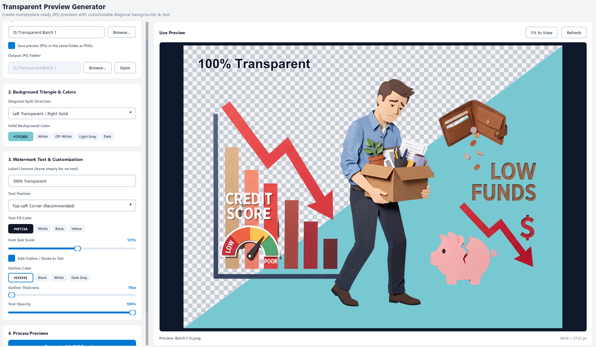
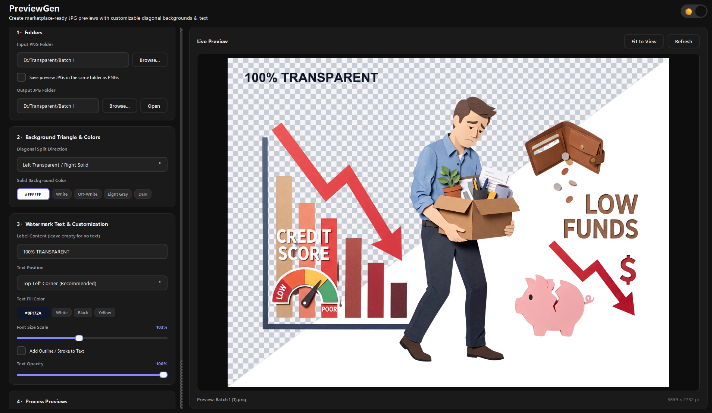

# PreviewGen

A cross-platform desktop app that turns transparent PNG files into professional JPG previews for marketplaces like Freepik, Adobe Stock, Shutterstock, and more.

<p align="center">
  
</p>

## What It Does

PreviewGen automates the creation of marketplace-ready JPG previews from your transparent PNG assets. Each preview features:

- **Diagonal split background** — checkerboard (transparency indicator) on one side, solid color on the other
- **Auto-centered object** — your PNG scales to fit while preserving aspect ratio
- **"TRANSPARENT BACKGROUND" badge** — instantly communicates the asset type
- **Customizable everything** — colors, text, fonts, badge, output quality
- **Batch processing** — hundreds of images in one click

## Features

| Feature | Description |
|---------|-------------|
| 🎨 **Dark & Light modes** | System-aware theme with manual toggle |
| 🖌️ **Full customization** | Text, outline, colors, badge, background, fonts |
| 📦 **Batch processing** | Process entire folders with progress tracking |
| ⚡ **Live preview** | See changes instantly before generating |
| 💾 **Persistent settings** | Remembers your last configuration |
| 🖼️ **Multiple aspect ratios** | Square, 4:3, 3:4, 16:9, custom |
| 🎯 **Freepik-ready** | Output meets marketplace requirements |

## Installation

### Windows (Recommended)
1. Download the latest `PreviewGen.exe` from [Releases](https://github.com/Mustaqeem66/Freepik-Prewview-Generator/releases)
2. Double-click to run — no installation needed
3. (Optional) Create a desktop shortcut

### macOS
```bash
# Download and install via terminal
curl -L https://github.com/Mustaqeem66/Freepik-Prewview-Generator/releases/latest/download/PreviewGen.dmg -o PreviewGen.dmg
hdiutil attach PreviewGen.dmg
cp -R "/Volumes/PreviewGen/PreviewGen.app" /Applications/
hdiutil detach "/Volumes/PreviewGen"
```

### Linux (AppImage)
```bash
# Download and run
curl -L https://github.com/Mustaqeem66/Freepik-Prewview-Generator/releases/latest/download/PreviewGen.AppImage -o PreviewGen.AppImage
chmod +x PreviewGen.AppImage
./PreviewGen.AppImage
```

### From Source (All Platforms)
```bash
# Requirements: Python 3.10+
git clone https://github.com/Mustaqeem66/Freepik-Prewview-Generator.git
cd Freepik-Prewview-Generator
python -m venv .venv
source .venv/bin/activate  # Windows: .venv\Scripts\activate
pip install -r requirements.txt
python main.py
```

## Quick Start

1. **Launch** PreviewGen
2. **Select Input Folder** — folder containing your transparent PNGs
3. **Select Output Folder** — where JPGs will be saved
4. **Customize** (optional) — adjust colors, text, badge, background
5. **Click "Generate JPG Previews"** — watch the progress bar
6. **Done** — JPGs appear in your output folder, ready to upload

## Customization Options

### Text Settings
- **Custom text** — replace default "TRANSPARENT BACKGROUND" badge
- **Font family & size** — system fonts + Google Fonts
- **Text color** — any hex/RGB value
- **Outline** — enable/disable, color, thickness

### Background Settings
- **Solid color** — pick any color for the solid triangle
- **Checkerboard colors** — customize both light/dark squares
- **Diagonal angle** — adjust split direction

### Output Settings
- **JPEG quality** (10–100)
- **Output dimensions** — presets or custom
- **Aspect ratio** — Square, 4:3, 3:4, 16:9, 1:1

## Screenshots

### Light Mode
<p align="center">
  
</p>

### Dark Mode
<p align="center">
  
</p>

## Project Structure

```
PreviewGen/
├── main.py              # Main application entry point
├── processor.py         # Image processing logic
├── requirements.txt     # Python dependencies
├── build_windows.bat    # Windows build script
├── run_app.bat          # Windows run script
├── setup_windows.bat    # Windows setup script
├── app.ico              # Application icon
├── preview.png          # Light mode preview
├── preview-dark.png     # Dark mode preview
├── .github/
│   └── workflows/
│       └── build.yml    # CI/CD pipeline
└── README.md
```

## Building from Source

### Windows (creates .exe)
```bash
./build_windows.bat
# Output: dist/PreviewGen/PreviewGen.exe
```

### macOS (creates .dmg)
```bash
# Requires: PyInstaller, create-dmg
pyinstaller --noconsole --name PreviewGen --icon=app.icns main.py
# Then use create-dmg to package
```

### Linux (creates AppImage)
```bash
# Requires: PyInstaller, appimagetool
pyinstaller --noconsole --name PreviewGen main.py
# Then use appimagetool to package
```

## CI/CD Pipeline

This project uses GitHub Actions for automated cross-platform builds:

- **Windows** → `.exe` (standalone)
- **macOS** → `.dmg` (drag-to-install)
- **Linux** → `.AppImage` (run anywhere)

Triggers on:
- Push to `main` branch
- New version tags (`v*`)
- Manual workflow dispatch

Artifacts are uploaded as release assets automatically.

## Requirements

- **Python** 3.10+
- **PySide6** (Qt6 bindings)
- **Pillow** (image processing)

All dependencies in `requirements.txt`.

## License

MIT License — free for personal and commercial use.

## Author

**Mustaqeem66** — [GitHub](https://github.com/Mustaqeem66)

---

⭐ Star this repo if PreviewGen saves you time!