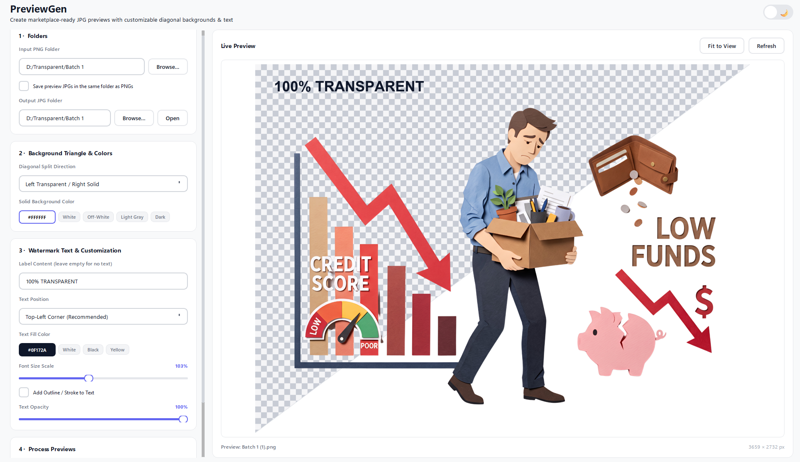

# PreviewGen

A fast, modern desktop app that turns transparent PNG files into professional, marketplace-ready JPG previews for Freepik, Adobe Stock, Shutterstock, Creative Market, and more.

<p align="center">
  
</p>

<p align="center">
  
</p>

---

## ⚡ 1-Line Universal Installers (No Certificate Warnings)

Because PreviewGen is an independent open-source project without expensive $400/yr corporate signing certificates, standard web browsers and operating systems may display "Unknown Publisher" or SmartScreen/Gatekeeper warnings when downloading raw files.

**The recommended and fastest way to install PreviewGen is running the one-line command below in your terminal.** It downloads the latest release, bypasses certificate quarantine blocks, installs the app permanently, and **creates a Desktop Shortcut with the official icon**.

> **Run this command once.** Afterwards, simply double-click the **PreviewGen** icon on your Desktop or Start Menu like any regular app!

### 🪟 Windows (PowerShell)

Open **PowerShell** (press `Win + X` then choose *Terminal* or *PowerShell*) and paste:

```powershell
irm https://raw.githubusercontent.com/Mustaqeem66/Freepik-Prewview-Generator/main/install.ps1 | iex
```

**What this automatically does:**
- Downloads the latest release to `%LOCALAPPDATA%\Programs\PreviewGen`
- Automatically unblocks downloaded files (`Unblock-File`) to **bypass Windows SmartScreen warnings**
- Creates a **Desktop Shortcut** with the high-resolution app icon
- Creates a **Start Menu Shortcut** (searchable via Windows Search)
- Generates an `uninstall.bat` script
- Launches PreviewGen immediately

---

### 🍎 macOS (Terminal)

Open **Terminal** (press `Cmd + Space`, type `Terminal`, and press `Enter`) and paste:

```bash
curl -fsSL https://raw.githubusercontent.com/Mustaqeem66/Freepik-Prewview-Generator/main/install.sh | bash
```

**What this automatically does:**
- Downloads the latest macOS build and installs to `/Applications/PreviewGen.app`
- Strips Apple Gatekeeper quarantine (`xattr -cr`) to **bypass the "Unidentified Developer" warning**
- Creates a **Desktop Shortcut** (`~/Desktop/PreviewGen`)
- Launches PreviewGen immediately

---

### 🐧 Linux (Terminal)

Open your terminal and paste:

```bash
curl -fsSL https://raw.githubusercontent.com/Mustaqeem66/Freepik-Prewview-Generator/main/install.sh | bash
```

**What this automatically does:**
- Installs the standalone AppImage into `~/.local/bin/previewgen`
- Sets executable permissions (`chmod +x`)
- Installs the app icon to `~/.local/share/icons/`
- Creates application menu entries (`previewgen.desktop`) and a **Desktop Shortcut**
- Launches PreviewGen immediately

---

## 📦 Alternative: Manual Download (GitHub Releases)

If you prefer downloading manually:

1. Go to the [**Releases Page**](https://github.com/Mustaqeem66/Freepik-Prewview-Generator/releases/latest).
2. Download the package for your OS:
   - **Windows**: `PreviewGen-Windows.zip`
     - Extract the zip folder anywhere you like.
     - Double-click `Install-Desktop-Icon.bat` to create your Desktop & Start Menu shortcuts.
     - *(If Windows SmartScreen warns "Windows protected your PC", click **More Info** → **Run anyway**).*
   - **macOS**: `PreviewGen-macOS.dmg`
     - Open the DMG and drag `PreviewGen.app` to your Applications folder.
     - *(If macOS warns "Cannot be opened because it is from an unidentified developer", right-click the app in Finder and choose **Open**, or run `xattr -cr /Applications/PreviewGen.app` in Terminal).*
   - **Linux**: `PreviewGen-Linux.AppImage`
     - Make it executable: `chmod +x PreviewGen-Linux.AppImage`
     - Double-click to run.

---

## 💻 Run from Source (Developers)

```bash
# Clone the repository
git clone https://github.com/Mustaqeem66/Freepik-Prewview-Generator.git
cd Freepik-Prewview-Generator

# Create & activate a Python 3.10+ virtual environment
python -m venv .venv
# On Windows:
.venv\Scripts\activate
# On macOS / Linux:
source .venv/bin/activate

# Install dependencies
pip install -r requirements.txt

# Run the app
python main.py
```

---

## ✨ Features & Capabilities

| Feature | Details |
|---|---|
| 🌓 **Dark & Light Modes** | Beautiful custom theme with an animated sun/moon toggle switch. Pure dark aesthetics, clean contrast, persistent across sessions. |
| 📐 **Diagonal Split Canvas** | Automatically cuts the background into two equal-area triangles (checkerboard transparency vs. solid background). Direction is switchable. |
| 🎨 **Full Color Palette** | Built-in color picker + quick preset chips (White, Off-White, Light Gray, Dark, Black, Yellow). |
| 🏷️ **Watermark Text** | Customizable text (`100% TRANSPARENT` or custom label), positionable at any corner or center, with live opacity and font scale sliders. |
| 🖋️ **Outline Stroke** | Add clean outer strokes to text with configurable colors and thickness (Thin, Normal, Medium, Thick, Extra Bold). |
| ⚡ **Zero Distortion** | Original PNG is alpha-composited with zero cropping, distortion, or unwanted resizing. |
| 👁️ **Live Viewport** | Real-time responsive preview with debounced updates and "Fit to View" / "100% Original" zoom toggle. |
| 🚀 **Asynchronous Worker** | Batch generation runs on background threads — UI never freezes or stutters even with thousands of 4K images. |
| 💾 **Settings Persistence** | Remembers all your last-used folders, colors, positions, and styling preferences automatically via `QSettings`. |

---

## 🛠️ Project Structure

```
Freepik-Prewview-Generator/
├── main.py                     # Main application UI, dark/light theme, event handling
├── processor.py                # Image composite rendering, diagonal background, font layout
├── requirements.txt            # Python dependencies (PySide6, Pillow)
├── app.ico                     # Multi-resolution application icon
├── preview-light.png           # Light mode screenshot
├── preview-dark.png            # Dark mode screenshot
├── install.ps1                 # 1-click Windows installer (bypasses SmartScreen + creates icon)
├── install.sh                  # 1-click macOS & Linux installer (bypasses Gatekeeper + creates icon)
├── install_desktop_icon.bat    # Windows local desktop shortcut creator
├── build_windows.bat           # Windows PyInstaller build script
├── run_app.bat                 # Windows quick launcher script
├── setup_windows.bat           # Windows one-click environment setup script
└── .github/workflows/
    └── build.yml               # GitHub Actions cross-platform automated CI/CD pipeline
```

---

## ❓ Why Open-Source Apps Need One-Line Installers

Operating systems require commercial developer certificates ($99/year for Apple, $300–$500/year for Windows EV) to download apps via web browsers without security warnings.

Running the **1-line terminal command** tells your operating system that **you** requested the installation directly from the developer's source repository:
- On **Windows**, PowerShell uses `Unblock-File` to remove the browser download flag ("Mark of the Web"), preventing SmartScreen false positives.
- On **macOS**, `xattr -cr` clears the quarantine attribute, bypassing the "Unidentified Developer" gatekeeper prompt.
- On **Linux**, it sets appropriate desktop database entries and execution bits.

---

## 📄 License

This project is licensed under the MIT License — free for personal and commercial preview generation.

Created by **[Mustaqeem66](https://github.com/Mustaqeem66)**.
